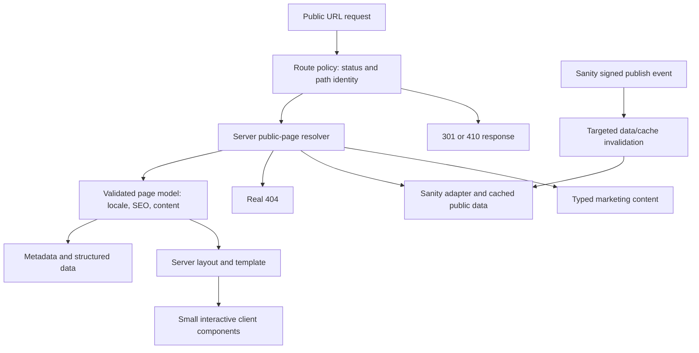

# Application architecture

Status: local SSR routing, recovered content and active-page templates implemented; Sanity and deployment remain planned. See [ADR-0002](adr/0002-public-routing-and-locales.md). D-17 places owner-directed redesign before expanded Arabic implementation; the [next-phase plan](12-redesign-and-arabic-delivery.md) describes future localized identities, shared templates and repository boundaries without claiming they are implemented.

## Current local content baseline

The owner's coverage-first instruction is implemented in [Chunk 9](chunks/09-complete-local-coverage.md). The default repository resolves all 118 retained identities: homepage/API presentation components plus 116 generated semantic documents. `src/content/site` owns validated body data; `src/components/content` owns reusable presentation. Source/plugin HTML, CSS classes/settings and executable scripts are not imported. Later family layouts cover all 107 active routes; exact source visual/state acceptance remains open.

[Chunk 12](chunks/12-active-navigation-scope.md) selects 107 active content pages for further
reconstruction under D-16. The eleven disconnected project/demo pages remain in the local
repository until their release SEO dispositions are reviewed. The scope audit is offline
tooling/documentation; application imports and request handling do not read its register or
captured live HTML.

Proxy validates the requested body before forwarding. Rendering and metadata share request-local resolution. The default body path is constrained to the generated document directory; isolated test bodies use an explicit file URL, avoiding a broad Proxy trace of unrelated JSON files. The build guard verifies every body is included and private evidence is excluded. The harness copies both the published index and documents and never mutates the source data.

[Chunk 10](chunks/10-article-family.md) adds a typed article presentation to the 42 recovered article documents. Their semantic nodes contain the complete article body; the shared article layout owns the surrounding title, categories, media, adjacent/related navigation, sharing and footer. The API article retains its independently reconciled body model and uses this same layout. Subsequent chunks add the other family layouts described below. Article presentation is required exactly for article-family documents; validation failures remain repository errors.

[Chunk 11](chunks/11-service-family.md) maps the reviewed service/location source structure to finite semantic roles and an explicit service layout. Thirty complete-main documents use the shared service page, floating shell and responsive service stylesheet. Source CSS is read only by offline tooling to recover reviewed alignment and provenance; it is never interpreted by the application. Article and service pages share floating-shell CSS. English header/footer copy has explicit English/LTR attributes under Arabic documents; published identity still controls navigation and server root locale.

Current listings are captured snapshots for local coverage. [Chunk 14](chunks/14-listing-pages.md)
adds source-derived Blog, category and author layouts through `ListingPage` and the same captured
page frame. Finite Blog query views are selected on the server from the validated Blog document;
they preserve one published identity and its source root canonical. Supplemental query HTML stays
outside application imports and is checked against the archived article identities and Blog SEO.
These snapshots are not the final editorial implementation: real Sanity publication must derive
and refresh listings, taxonomies and related content. There is no CMS client or cross-request
fixture cache in this baseline. The target architecture below describes that later workflow.

[Chunk 13](chunks/13-company-pages.md) adds five identity-bound company layouts. `CompanyPage`
and `ServicePage` use `CapturedPageFrame` for their common floating shell, main region and SEO.
Reviewed company roles preserve distinct source structure, hidden content and local icon glyphs;
the seven background roles enter the same backup/media validation pipeline as content images.
The runtime consumes typed documents and allowlisted role URLs, never source CSS/settings.

## Architectural shape

[Chunk 15](chunks/15-visual-motion-alignment.md) adds eight identity-bound secondary layouts,
completing the first presentation pass for all 107 active pages. The profile/taxonomy/team/credits
converter shares the same validated document/media pipeline and captured-page frame. Its source
HTML, rendered portrait styles and backup CSS remain offline provenance, not application imports.
Finite entrance settings live in `src/content/motion`; `SiteMotion` is the small browser-only
observer/animation enhancement. Server content is visible by default, and reduced motion/focus
cancel owned animations. This is independent of routing, resolution, metadata and repository
freshness. Strict visual acceptance and real integrations remain open.

[Chunk 16](chunks/16-homepage-load-alignment.md) moves homepage first-paint entrances to finite
CSS animations, independent of hydration. The observer skips already-visible content so late
enhancement cannot hide it. `SiteFonts` preloads the existing local text fonts. `HomeMarquee`
owns only ribbon loop sizing/visibility; reduced motion and no-JavaScript static rendering are
independent of the routing/content pipeline.

[Chunk 17](chunks/17-services-interactions.md) centralizes button class selection in
`button-styles.ts`. Services actions and homepage card actions share the same button surface
and interaction CSS; standalone Services CTAs use `ButtonLink`. The Services document context
groups graphic/copy content and keeps a single full-card anchor. It adds no click-handler or
page-specific button controller, and preserves locale-aware native/Next navigation.

[Chunk 18](chunks/18-about-alignment.md) enables that same `ButtonLink` path for About and
removes its duplicate interaction CSS. The offline company converter records the exact
placeholder Services-action correction; semantic text, route identity and SEO are unchanged.

[Chunk 19](chunks/19-remaining-pages-alignment.md) applies the same class contract to service,
listing and enquiry actions. Services copy grouping is explicit and independent of button
styling, preserving Arabic card layout. Company actions use document navigation across
languages. The offline converter repairs the Contact phone/email wrapper with exact-text
preservation; source evidence is never imported at runtime. Classed source article quotations
map to a finite `plain-quote` semantic role; unclassed quotations retain the theme treatment.
Body-based image spacing and table-paragraph spacing avoid inheriting heading geometry.
The final complete gate passes 1,110 tests with all 107 active routes captured at three sizes;
strict visual/state acceptance and real integrations remain separate.

[Chunk 20](chunks/20-article-fidelity-follow-up.md) adds an offline article-document converter
for reviewed compact text, inline images and heading-led prose groups. The independent API
converter stays unchanged. Known empty pasted editor headings are omitted without discarding
content/anchor identities. The shared article layout groups header taxonomy links into the
source pill, featured-image widths follow intrinsic aspect ratios, and related actions inherit
the homepage interaction system. Table formatting whitespace moves to valid cell content in
the same flattened text order. Floating menu flex layout centers its existing source SVG.

The eleven recovered service process widgets use `ContentTabs` with server-rendered slots.
`tabs-controller.ts` owns scoped selection, ARIA relationships, keyboard navigation and the
mobile disclosure mode; cleanup removes its listeners and restores readable content. The
offline converter validates matching desktop/mobile labels, panel IDs and the initial source
selection. All content remains visible without JavaScript. No WordPress tab runtime is loaded.

Use one Next.js application with a focused Sanity integration. Keep marketing content in typed route/section data and blog content in Sanity. Both flow through a small public-page model used by rendering, metadata and verification. This avoids parallel implementations of URL ownership and SEO.

Layouts and page composition use Server Components. Client Components own only actual browser state or interaction. Next.js documents these boundaries in its [Server and Client Components guidance](https://nextjs.org/docs/app/getting-started/server-and-client-components). The module design below is project-specific engineering judgment.



## Module responsibilities

| Module | Owns | Must not own |
| --- | --- | --- |
| `routing` | Public-path identity, typed route results, legacy status rules, reserved paths | Marketing markup, CMS editing UI or broad substring redirects |
| `content` | Marketing page data, public-page contracts, content validation | Network clients or browser state |
| `blog` | Article/listing composition, taxonomy, public content use cases | Direct CMS secrets or private drafts in public responses |
| `sanity` | Schemas, generated types, queries, server clients, document mapping | UI-specific CSS or duplicated route/SEO policy |
| `seo` | Metadata mapping, canonical/alternate policy, safe JSON-LD serialization | Independent guesses about page content or redirects |
| `site` | Header/footer/navigation variants and shared site composition | A global client store for otherwise server-rendered content |
| `forms` | Field/schema contracts, server handler, transport boundary, safe feedback | Hardcoded unverified recipients or false success states |
| `ui` | Small reusable visual/accessible primitives | CMS fetching, routing policy or one component for every possible page |

Keep these as focused folders, not internal packages. Split packages/services only after a concrete independent lifecycle requires it. Use direct imports or narrow explicit exports; do not create layers of barrel files that obscure dependencies.

Blog/category/author/listing routes use application templates but derive their public article/taxonomy data from Sanity. A route-register `content_owner=application` identifies composition ownership; it is not permission to freeze a WordPress article listing as hardcoded markup. CMS publication must update these derived views.

## Proposed repository layout

This is the intended allocation of responsibilities, not a requirement to create empty files. Names can be adjusted during implementation with documentation updated in the same change.

```text
docs/                              Migration requirements, decisions and runbooks
scripts/                           Existing capture/audit tools; later import utilities
src/
  app/
    (public)/
      layout.tsx                   Public root layout; correct server locale/direction
      [[...path]]/page.tsx          Thin typed route-to-page composition
      not-found.tsx                Real missing-page UI
      error.tsx                    Accessible public error boundary
    studio/
      layout.tsx                   Separate Studio root; avoids public shell/bundle
      [[...tool]]/page.tsx          Authenticated Sanity editing interface
    api/
      contact/route.ts              Validated form submission boundary
      preview/route.ts              Authenticated draft-mode entry
      preview/disable/route.ts      Safe draft-mode exit
      revalidate/route.ts           Verified webhook handling
    robots.ts
    sitemap.ts
    favicon.ico
  components/
    ui/                            Button, container, icon and form primitives
    site/                          Header, navigation, footer and shell variants
    sections/                      Real repeated marketing sections
  features/
    blog/                          Article, archive, taxonomy and related content
    forms/                         Field schemas, components and use cases
    search/                        Search interface, query contract and results
  content/
    pages/                         Typed marketing content by actual page family
    navigation/                    Locale-aware navigation data
    assets/                        Public media identity and usage map
  lib/
    routing/                       Route registry/resolver and normalization
    sanity/                        Server clients, queries, mapping and cache policy
    seo/                           Metadata/JSON-LD/sitemap helpers
    env/                           Validated server/public environment boundaries
    observability/                 Safe structured diagnostics
  sanity/
    schemas/                       Blog/editorial schema definitions
    generated/                     Tool-generated types; never hand-edited
  styles/
    globals.css                    Resets, extracted tokens and global rules
    article.css                    Rich-content typography where utilities obscure intent
  proxy.ts                         Narrow public-path policy/header boundary if selected
public/
  brand/                           Approved logo/icons/static brand assets
  media/                           Approved local design assets
tests/
  fixtures/                        Representative English/Arabic source fixtures
  integration/                     Route, CMS, import and transport contracts
  e2e/                             Navigation, forms, editor preview and public behavior
  visual/                          Per-route/state comparisons and environment manifest
```

Colocate small unit/component tests with their modules where it improves ownership. Large test reports and captures live in CI artifact storage or ignored local directories, with durable references in the registers. Keep root configuration limited to tools actually used.

## Public-page and route contracts

Represent route outcomes as a discriminated union such as `page`, `redirect`, `gone` and `notFound`. A page result contains stable identity, public path, content kind, locale, SEO and typed template data. Redirect results contain exact source matching, status and destination. No module guesses a page type from a loose substring of the pathname.

Use explicit ownership for known marketing paths and reserved system routes. Resolve CMS-owned root article paths through the Sanity adapter. A collision between a CMS path and a marketing/system/legacy path is a validation error, not a priority accident.

Preserve encoded path semantics. Decode only where justified, reject malformed encodings, avoid double decoding, and do not turn `%2F` into an unintended path separator. Percent-escape case equivalence is distinct from changing case-sensitive path text. Test real Arabic paths and malformed probes.

Apply status rules before content streaming. Preserve appropriate trailing-slash behavior without creating extra redirect chains. Unknown public paths must not receive a generic marketing page with HTTP 200.

## Locale and rendering decision

The starting direction is a public-path resolver with server-derived locale and HTML attributes. A narrow request boundary supplies a trusted public pathname; the server resolver loads the page once per request, determines `en`/`ar`, and provides consistent data to layout, metadata and page composition. Incoming client-supplied internal routing headers are overwritten.

This direction implies a request-rendered public root layout. Cache reusable public content/data explicitly and deduplicate request-level resolution; do not describe these routes as fully statically generated or claim ISR of the entire page without implementation proof. New Sanity articles must become visible through the defined publish/revalidation flow without a developer manually deploying route files.

Root layouts can persist during client navigation. With this starting approach, cross-language links must perform a full document navigation so server-emitted `lang`/`dir` and shell locale cannot remain stale; same-language navigation can use the normal client router. Do not rely on client-side patching of HTML attributes as the primary language implementation. Verify cross-language back/forward behavior too.

Chunk 1 selects request-derived SSR for the local proof. A locale-parameter internal rewrite remains a future option if deployment measurements show a useful static-generation benefit. That alternative needs a coherent, updatable locale/path index and must prevent internal locale URLs becoming public duplicates. Do not combine both approaches casually. Record the tested choice in ADR-0002 before expanding the file tree.

Next.js supports locale-aware root layouts, but its [internationalization examples](https://nextjs.org/docs/app/guides/internationalization) do not by themselves preserve this site's existing flat URLs. The prototype must establish that additional contract.

## HTTP errors and redirects

Preserve 301 explicitly: the framework's permanent redirect option normally emits 308, which is not exact status parity. Next.js also supports explicit status configuration as described in its [redirect documentation](https://nextjs.org/docs/app/api-reference/config/next-config-js/redirects).

Use a tested provider-native or application response mechanism for true 410 behavior. `notFound()` represents 404 and is not a 410 implementation. If the chosen deployment layer requires a static branded gone document, generate it from the same tokens/presentational source and test it against the archived gone-page behavior. Do not keep an unrelated hand-maintained copy of the site shell.

Resolve unknown/gone cases before a streamed successful response can turn them into soft 200s. Avoid an unexamined public `loading.tsx` that changes status behavior. Test deployed GET/HEAD, direct requests, client navigation and cache hits.

## Data and cache boundaries

- Cache published content only under explicit document/path/query identities. Define how list, category, related-content and sitemap data invalidates when an article changes.
- Deduplicate layout/page/metadata reads using the appropriate request-level mechanism for the pinned framework. Cross-request data caching has a separate policy.
- Preview reads use draft-aware server access and bypass public caches. Draft identity, HTML and metadata cannot contaminate public cache keys.
- Define bounded timeout/retry behavior and stale published-data handling. A CMS error must not masquerade as a real missing document or silently serve unrelated content.
- Reject stale/replayed invalid webhook events safely and make duplicate valid events idempotent. Invalidate only affected content and dependent listings.
- Revalidation is not complete until a public fetch proves the expected published version is visible within the agreed freshness target.

## API and operational boundaries

Validate untrusted input at form, webhook, preview and import boundaries. Keep transport-specific code behind small adapters that can be exercised with controlled test implementations. Do not add a dependency-injection framework merely to replace a function in a test.

Public environment values and server secrets have separate schemas/import paths. Use structured logs with correlation identifiers, route/document identity and safe error classifications; omit article drafts, message bodies, addresses, tokens and raw SQL.

A public HTML response must contain useful content and required SEO without JavaScript. The metadata behavior must be checked against the pinned framework's streaming behavior; adopt its supported blocking configuration where needed and verify actual HTTP output. See [Next.js metadata](https://nextjs.org/docs/app/api-reference/functions/generate-metadata).

## Authored customer journeys

D-20 adds a small authored layer under `src/content/journey/`, with explicit core-page
identities, four commercial offers, specialist membership, article recommendations and copy.
It is independent of recovered WordPress visual classifications. Server compositions under
`src/components/journey/` reuse existing frames, actions, media and captured supporting-page
renderers. Metadata, routing and repository resolution retain their existing owners; the
journey layer introduces no cross-request cache, CMS scaffold or generic page builder.

The [customer journey contract](13-customer-journey.md) documents module responsibilities,
published-target validation, source preservation, search and verification. Its finite
editorial ledger identifies approved changes without editing recovery documents or SEO records.

## Shared header and menu

D-21 replaces the Home/floating header variants with one server-rendered SiteHeader and
one responsive style owner. It retains the English shared shell on Arabic documents, current
language-navigation behavior, route-derived active sections and existing enquiry/search contracts.
Only the mobile menu lifecycle is client controlled: native modality, viewport-bounded scrolling,
interruptible opening/dismissal, reduced motion and keyboard boundaries. Search keeps its own
existing lifecycle. The [header work record](page-reviews/unified-header.md) records breakpoints,
cleanup behavior and verification; page content, routing and SEO ownership are unchanged.

## Shared section alignment and Contact composition

D-22 introduces one visible-content maximum and responsive-gutter contract, used by the existing
page families. Surface panels align to the content edges; article prose retains a narrower
reading measure and backgrounds can remain full bleed. Contact uses an explicit authored
server composition with recovered images, map and enquiry controls. Blog topic selection is a
small native-dialog client island with a no-JavaScript directory. Related cards use intrinsic
CSS sizing instead of client height measurements. See the [UI consistency record](page-reviews/ui-consistency-contact.md)
for preservation details and the owner-requested focused verification boundary.

## Shared footer and brand assets

D-23 gives the shared server footer one responsive layout in `footer.css`, using existing
navigation/offer labels, explicit direct offer paths and the Contact facts module. It preserves
locale-aware links and copyright overrides. Original local favicon variants are declared once
in `content/home/brand.ts` for root metadata and the proxy asset allowlist, with provenance
checksums alongside. See the [brand/footer record](page-reviews/brand-contact-footer.md).

## Service card alignment and disclosure enhancement

D-24 annotates structurally matching linked service columns for shared CSS grid rows and the
existing glass surface. `AnimatedDisclosure` is the single native disclosure enhancement used
by recovered content and authored specialist lists; bodies remain server rendered. Its client
boundary owns only interruptible height/opacity motion, focus exclusion while closing and
reduced-motion behavior. See the [service/disclosure record](page-reviews/service-cards-disclosures.md).

## Service-family composition revision

D-25 shares `ServiceSections` between specialist pages and the four offer compositions. It groups
consecutive capability panels without combining page identities or rewriting source bodies.
Presentation annotations remove spacer columns, relocate action-only columns after their section
copy and mark supporting links; `service-layout.css` owns the calmer visual hierarchy. The
[service layout record](page-reviews/service-layout-redesign.md) defines the editorial/preservation
boundary and focused checks.

## Architecture acceptance

G1/G2 evidence must demonstrate locale/status correctness, new article publication, reserved-path protection, public/preview cache separation, server-only secret imports and a production build. G4 must demonstrate that the structure supports faithful templates without excessive props, duplicated shells or a giant generic page renderer.
